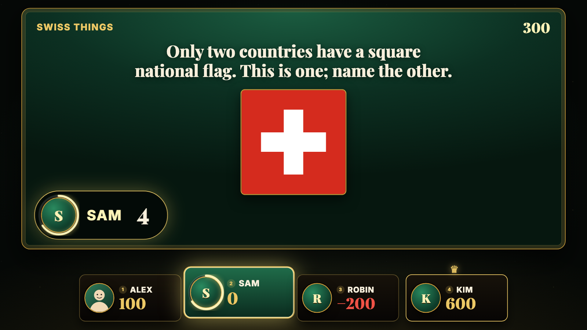
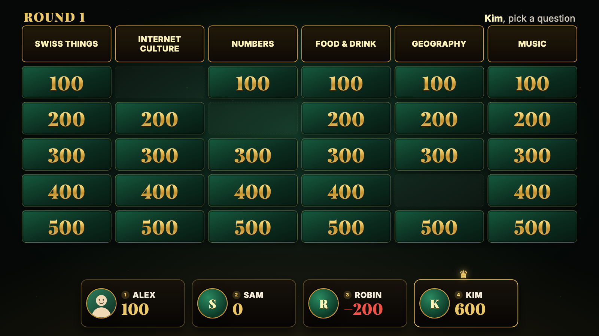
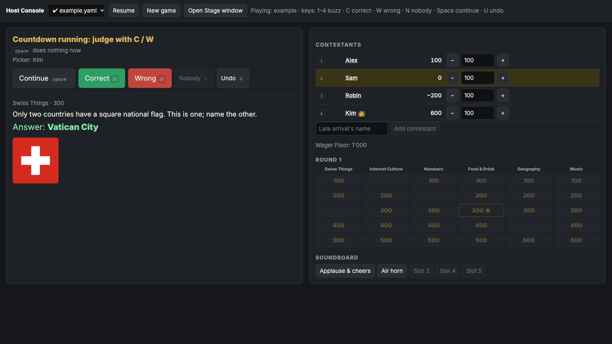

# Moltiboso Money

A home-made trivia game show for a living room, inspired by Ludwig's _Mogul Money_ (itself a take on Jeopardy!).

One person hosts from a laptop; everyone else sits on the sofa facing a TV. The TV shows a polished, game-show-style **Stage**: the board, each question, scores and animations. The laptop keeps a plain **Host Console** with the answers and the controls. Buzzing in happens with physical lockout buzzers: the host just presses the number of whoever buzzed first.

All the content (contestants, categories, questions, sounds) lives in one YAML file per game night, so writing a new game needs no code.

> **Unofficial hobby project.** Moltiboso Money is a fan-made game for playing with friends at home. It is not affiliated with, endorsed by or connected to Ludwig Ahgren, _Mogul Money_ or its producers, or _Jeopardy!_ and its owners. We don't own the game show format or those names; all trademarks belong to their respective owners. No logos, footage, music or other material from those shows is included: the code, design, questions and sounds here are original or come from free-to-use sources (see [Credits](#credits)).



| The Board                                                                 | The Host Console (laptop screen)                                                                           |
| ------------------------------------------------------------------------- | ---------------------------------------------------------------------------------------------------------- |
|  |  |

## How a game plays

- **Two rounds** of 6 categories × 5 values; Round 2 values are doubled. The board shape is up to the game file.
- The **Picker** (whoever answered last correctly) chooses a question. Anyone can buzz in; a wrong answer costs the value and the others may **steal**.
- **Bonus Questions** are hidden on the board: only the Picker answers, after placing a wager.
- The **Final Wager**: everyone bets secretly, writes an answer on paper, and the Stage reveals them one by one, lowest score first.
- Questions can have **images, GIFs and audio**. There's an optional answer countdown, sound effects, contestant intros and a winner podium with confetti.

The exact rules and vocabulary are in [CONTEXT.md](CONTEXT.md).

## Game night

You need [Node.js](https://nodejs.org/) and a laptop that can drive a TV as an **extended** (not mirrored) display.

1. `npm install` (once), then `npm run dev`. The Host Console opens in your browser.
2. Pick a game file, then **New game** (or **Resume** to continue a saved one).
3. Click **Open Stage window**, drag it onto the TV, click it once (this enables sound), and press **F** for fullscreen.
4. Back in the Host Console, run the show with the keyboard:

| Key       | Does                                                                                |
| --------- | ----------------------------------------------------------------------------------- |
| `Space`   | Continue: intros → Board, start the countdown, reveal the answer, back to the Board |
| `1`–`6`   | That contestant buzzed in (press another number to correct a mis-press)             |
| `C` / `W` | Correct / wrong                                                                     |
| `N`       | Nobody buzzed: end the question                                                     |
| `U`       | Undo the last step (as many times as you like)                                      |

Pick questions by clicking the mini-board. For a Bonus Question or the Final Wager, type wagers into the boxes and press `Space`.

The game saves after every step: closing or reloading either window resumes where you were. Only **New game** discards a save.

## Writing a game

Copy [games/example.yaml](games/example.yaml) (60 sample questions) to e.g. `games/2026-11-07.yaml` and edit it. Put images, GIFs and audio in `games/media/`. Then check it:

```sh
npm run check                         # all game files
npm run check games/2026-11-07.yaml   # just one
```

Edits to questions apply immediately, even mid-game. Contestants are fixed at New game; latecomers join with **Add contestant**.

Game files can also live in subfolders of `games/`. Media paths are relative to the game file, so a game in `games/friends/` uses `media/...` for its own files and `../media/...` for the shared ones.

### Keeping your games private

Your games will contain your friends' names, photos and inside jokes, so don't commit them to a public fork. `games/private/` is git-ignored for exactly this: make it its own (private) git repository and your games show up in the game picker as `private/...`:

```sh
git clone https://github.com/<you>/<your-private-games-repo>.git games/private
```

## Sounds: please replace them

The game ships with deliberately modest sounds so the repo stays free to share:

- The show's effects (reveal, correct, wrong, bonus fanfare, countdown, drum roll, coins, win) are **generated in the browser**.
- The Soundboard has an **applause** and an **air horn** made from public-domain Wikimedia Commons recordings ([credits](games/media/sfx/CREDITS.md)).

They work, but they are not the real thing. **For maximum fun factor, swap in your own**: the proper meme air horn, your group's inside jokes, a dramatic sting for the Final Wager. Drop the files into `games/media/` and point the game file at them:

```yaml
sounds:
  correct: media/sfx/my-ding.mp3 # override any built-in effect
  bonus: media/sfx/dramatic.mp3
  soundboard: # up to 5 buttons in the Host Console
    - { label: Air horn, file: media/sfx/real-airhorn.mp3 }
    - { label: Sad trombone, file: media/sfx/wah-wah.mp3 }
```

Built-in effects you can override: `reveal`, `correct`, `wrong`, `bonus`, `tick`, `timeUp`, `think`, `drumroll`, `coins`, `win`. Soundboard and question audio play from the Host Console; everything else plays from the Stage.

If you publish your fork, keep sounds you don't have the rights to out of it, e.g. in `games/private/`.

## How it's built

A Vite + React + TypeScript app with no backend. The Stage and the Host Console are two windows of the same app, kept in sync over a `BroadcastChannel`, with the game saved to `localStorage` ([why](docs/adr/0001-two-windows-broadcastchannel.md)). The rules live in a pure, tested state machine in `src/engine/`.

`npm test` runs the rule tests, `npm run typecheck` the compiler, `npm run format` Prettier.

## Credits

- Sounds: edited from public-domain / CC0 recordings on Wikimedia Commons, see [games/media/sfx/CREDITS.md](games/media/sfx/CREDITS.md). All other sound effects are synthesized in code.
- Fonts: [Playfair Display](https://fonts.google.com/specimen/Playfair+Display) and [Inter](https://fonts.google.com/specimen/Inter), loaded from Google Fonts (SIL Open Font License).
- Sample images (`games/media/`) were made for this project.

## License

[MIT](LICENSE) © 2026 fetsackz. The license covers this project's own code and content; the disclaimer above still applies to the names of the shows that inspired it.
